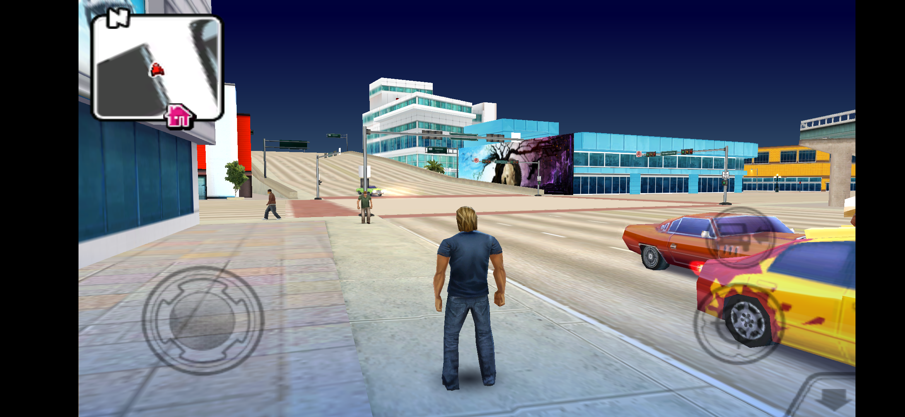

# Gangstar: Miami Vindication: fix para Android moderno

🌐 **Español** · [English](README.md) · [Português](README.pt-BR.md)

APK parcheado de **Gangstar: Miami Vindication v1.0.6 "Fix"**, el mod de **David Rice (gameloftrepairgames)**, que **no crashea al reabrir el juego** y funciona con el APK re-firmado. Probado en un Samsung Galaxy A34 5G con Android 16.

> Proyecto de fans sin fines de lucro, sin relación con Gameloft. Gangstar es propiedad de Gameloft. El juego fue retirado de las tiendas; esto es un archivo de conservación. Si Gameloft solicita su retiro, será retirado.

## Capturas

<p align="center">
  
  <br>
  
  
</p>

<p align="center"><em>Corriendo en un Samsung Galaxy A34 5G, Android 16.</em></p>

## El problema original

El juego abre bien **la primera vez** que se instala. Pero en cuanto se crea el archivo de guardado, el siguiente arranque falla:

1. Instalas el APK del mod y lo abres: funciona.
2. Juegas, cambias algún ajuste y sales (botón atrás). En ese momento el juego escribe `Gangstar2.preferences` en la memoria interna de la app.
3. Al volver a abrir (o tras `am force-stop`), **el juego se cierra justo después del logo de Gameloft**.

Pasa con el APK original sin modificar. Mientras el archivo no exista, el juego nunca falla; desde que existe, falla siempre. Borrar la carpeta `Gangstar2` de la `/sdcard` no ayuda, porque el guardado y las preferencias viven en la memoria interna de la app. El log mostraba:

```
Abort message: 'stack corruption detected (-fstack-protector)'
libGangster2.so (Preferences::LoadAndApply(char const*)+734)
```

## Instalación

1. Descarga `gangstar-miami-vindication-fixed.apk` desde **Releases**.
2. Copia los datos del juego a `/sdcard/gameloft/games/Gangstar2` (los mismos del mod original; ahí está `intro.m4v`).
3. Si tienes instalado el APK original del mod, **desinstálalo primero**: la firma es distinta y se pierde la partida.
4. Instala y abre.

```bash
adb install --bypass-low-target-sdk-block gangstar-miami-vindication-fixed.apk
```

El `--bypass-low-target-sdk-block` es necesario porque el APK original declara `targetSdk=5`.

**SHA-256 del APK:** `036cb223cbe11e08a881a80a8d34f0babcad66b8db2018dfbe2e98b2fd985a67`

## Requisitos

- Android con soporte para apps de 32 bits (ABI `armeabi`). Probado en Android 16 (Galaxy A34 5G, arm64 con soporte 32-bit).
- Los datos del juego en `/sdcard/gameloft/games/Gangstar2`.
- No probado en otros dispositivos ni versiones de Android.

## Qué se arregló

| # | Síntoma | Cuándo |
|---|---|---|
| 1 | El juego se cierra justo después del logo de Gameloft | Desde el segundo arranque, con el archivo de guardado ya creado |
| 2 | El APK re-firmado se cierra solo tras el logo | Siempre, desde el primer arranque |

### 1. `sprintf("%f", int)` desborda un buffer de pila

`Preferences::LoadAndApply(char const*)` en `libGangster2.so` lee `Gangstar2.preferences`. Al aplicar el volumen de la música hace:

```
memset(buf, 0, 96);
sprintf(buf, "%f", <entero del archivo>);   // 0x2c059c
```

El formato `%f` espera un `double`, pero se le pasa un entero. En la ABI ARM el `double` se lee de `r2:r3`: `r2` trae el entero y `r3` trae basura. El resultado es un número gigante impreso en decimal que no cabe en 96 bytes y pisa el canario de la pila. Es consistente con lo observado: aborto por `stack corruption detected (-fstack-protector)` y, sin el chequeo del canario, registros llenos de dígitos ASCII.

El resultado del `sprintf` no se usa (el volumen se aplica desde el entero crudo), así que basta con anularlo.

**Parche:** en `lib/armeabi/libGangster2.so`, offset de archivo `0x2c059c`:

```
b4 f7 fa e9   (blx sprintf)   ->   00 bf 00 bf   (nop; nop)
```

### 2. `libStormGLOFT.so` lee el certificado del propio APK

`libStormGLOFT.so` (la librería del mod que instala hooks en `libGangster2.so`) abre el APK como zip, recorre las entradas `META-INF/*.RSA` y las lee. Si no encuentra el certificado original, el juego llama a `nativeExit` por su cuenta (`Native Exit Triggered` y `System.exit(0)`) durante `Application::Init`. No es un crash: es una salida voluntaria.

Qué hace storm exactamente con el `.RSA` (compararlo, hashearlo, etc.) **no se terminó de aclarar**. Lo probado: si el `MYAPP.RSA` original sigue dentro del zip, el juego arranca aunque el APK esté firmado con otra clave.

**Solución:** mover `MYAPP.RSA` a `META-INF/o/MYAPP.RSA` (storm lo encuentra ahí y `apksigner` no lo borra), quitar `MANIFEST.MF` y `MYAPP.SF` originales y firmar **solo con esquema v2**.

## Compilarlo tú mismo

Con tu propio `orig.apk` del mod original (https://archive.org/details/gangstar-miami-vindication-data):

```bash
keytool -genkey -v -keystore debug.jks -alias k -keyalg RSA -keysize 2048 -validity 10000 \
        -storepass android -keypass android -dname "CN=debug"
python3 patch_gangstar.py orig.apk salida.apk
```

Necesita `python3`, `zipalign` y `apksigner`. `patch_gangstar.py` verifica que los bytes de `0x2c059c` coincidan antes de parchear.

## Verificación

```bash
adb logcat -c
adb shell monkey -p com.gameloft.android.GAND.GloftGMHP.ML -c android.intent.category.LAUNCHER 1
sleep 20
adb shell pidof com.gameloft.android.GAND.GloftGMHP.ML
adb logcat -d | grep -i "Native Exit\|App Init Succ\|Fatal signal"
```

Esperado: un PID, `App Init Successful` y ningún `Native Exit Triggered`. Para el bug 1: cambia un ajuste, sal con atrás, `am force-stop` y reabre.

## Qué NO funciona (descartado)

| Intento | Resultado |
|---|---|
| Anular el chequeo del canario en `LoadAndApply` | Cambia el abort limpio por un `SIGBUS`: la pila queda destruida |
| Anular el hook `nativeExit` de storm (`0x3246e`) | Evita la salida pero deja **pantalla negra** (audio y táctil siguen) |
| `android:debuggable=true` | No influye |
| Nombre del firmante v1, `zipalign`, instalación incremental | No influyen |
| Nopear el flag que lee `nativeExit` (`0x368916`) | Sin efecto: hay otros llamadores |

El historial completo está en [`LOG.md`](LOG.md).

## Limitaciones conocidas

- Solo se anuló el `sprintf` de la música. No se confirmó si existe otro equivalente en la rama del volumen de efectos.
- El APK está firmado con una clave de pruebas (`CN=debug`). Para actualizar sobre una instalación existente hace falta un APK firmado con esa misma clave.

## Créditos

- Juego original: Gameloft.
- Mod "Fix" / "Vindication" para dispositivos modernos: **David Rice (gameloftrepairgames / Gameloft Repair Games)**.
- Análisis y parche para Android 16: este repositorio.
- Análisis asistido por Claude (Anthropic).
