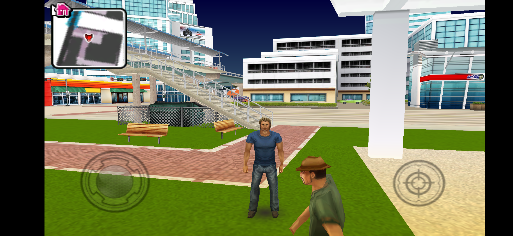
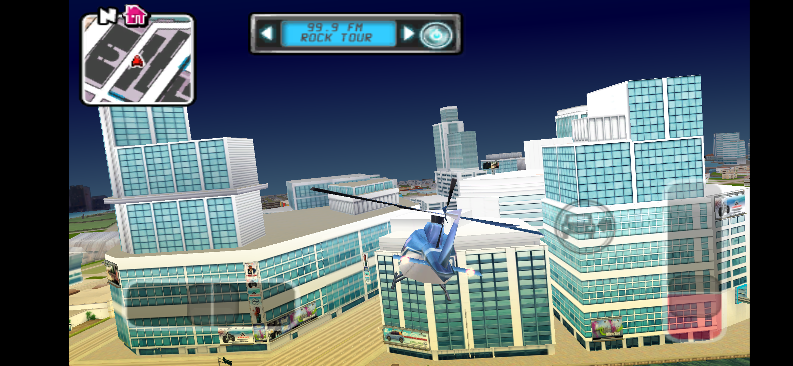
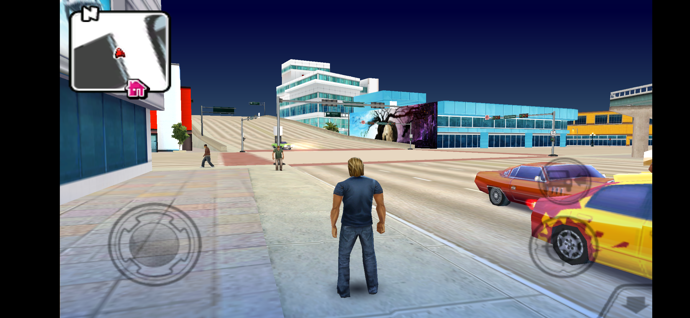

# Gangstar: Miami Vindication: fix for modern Android

🌐 [Español](README.es.md) · **English** · [Português](README.pt-BR.md)

Patched APK of **Gangstar: Miami Vindication v1.0.6 "Fix"**, the mod by **David Rice (gameloftrepairgames)**, that **no longer crashes when you reopen the game** and works with a re-signed APK. Tested on a Samsung Galaxy A34 5G running Android 16.

> Non-commercial fan project, not affiliated with Gameloft. Gangstar is owned by Gameloft. The game was pulled from the stores; this is a preservation archive. If Gameloft requests its removal, it will be removed.

## Screenshots

<p align="center">
  
  <br>
  
  
</p>

<p align="center"><em>Running on a Samsung Galaxy A34 5G, Android 16.</em></p>

## The original problem

The game launches fine **the first time** after installing. But as soon as the save file is created, the next launch fails:

1. You install the mod APK and open it: it works.
2. You play, change a setting and exit (back button). At that point the game writes `Gangstar2.preferences` to the app's internal storage.
3. When you reopen it (or after `am force-stop`), **the game closes right after the Gameloft logo**.

This happens with the unmodified original APK. While the file doesn't exist the game never fails; once it exists it always fails. Deleting the `Gangstar2` folder from `/sdcard` doesn't help, because the save and preferences live in the app's internal storage. The log showed:

```
Abort message: 'stack corruption detected (-fstack-protector)'
libGangster2.so (Preferences::LoadAndApply(char const*)+734)
```

## Installation

1. Download `gangstar-miami-vindication-fixed.apk` from **Releases**.
2. Copy the game data to `/sdcard/gameloft/games/Gangstar2` (the same data as the original mod; `intro.m4v` is in there).
3. If you have the original mod APK installed, **uninstall it first**: the signature is different and your save will be lost.
4. Install and open.

```bash
adb install --bypass-low-target-sdk-block gangstar-miami-vindication-fixed.apk
```

`--bypass-low-target-sdk-block` is required because the original APK declares `targetSdk=5`.

**APK SHA-256:** `036cb223cbe11e08a881a80a8d34f0babcad66b8db2018dfbe2e98b2fd985a67`

## Requirements

- Android with 32-bit app support (ABI `armeabi`). Tested on Android 16 (Galaxy A34 5G, arm64 with 32-bit support).
- Game data in `/sdcard/gameloft/games/Gangstar2`.
- Not tested on other devices or Android versions.

## What was fixed

| # | Symptom | When |
|---|---|---|
| 1 | The game closes right after the Gameloft logo | From the second launch on, once the save file exists |
| 2 | The re-signed APK closes by itself after the logo | Always, from the first launch |

### 1. `sprintf("%f", int)` overflows a stack buffer

`Preferences::LoadAndApply(char const*)` in `libGangster2.so` reads `Gangstar2.preferences`. When applying the music volume it does:

```
memset(buf, 0, 96);
sprintf(buf, "%f", <integer from the file>);   // 0x2c059c
```

The `%f` format expects a `double`, but an integer is passed. On the ARM ABI the `double` is read from `r2:r3`: `r2` holds the integer and `r3` holds garbage. The result is a huge number printed in decimal that doesn't fit in 96 bytes and overwrites the stack canary. This matches what was observed: an abort with `stack corruption detected (-fstack-protector)` and, with the canary check disabled, registers full of ASCII digits.

The result of the `sprintf` is never used (the volume is applied from the raw integer), so simply nulling it out is enough.

**Patch:** in `lib/armeabi/libGangster2.so`, file offset `0x2c059c`:

```
b4 f7 fa e9   (blx sprintf)   ->   00 bf 00 bf   (nop; nop)
```

### 2. `libStormGLOFT.so` reads the APK's own certificate

`libStormGLOFT.so` (the mod's library that installs hooks into `libGangster2.so`) opens the APK as a zip, walks the `META-INF/*.RSA` entries and reads them. If it doesn't find the original certificate, the game calls `nativeExit` on its own (`Native Exit Triggered` and `System.exit(0)`) during `Application::Init`. It isn't a crash: it's a voluntary exit.

What storm does exactly with the `.RSA` (compare it, hash it, etc.) **was not fully clarified**. What is proven: if the original `MYAPP.RSA` is still inside the zip, the game starts even if the APK is signed with a different key.

**Fix:** move `MYAPP.RSA` to `META-INF/o/MYAPP.RSA` (storm finds it there and `apksigner` doesn't delete it), remove the original `MANIFEST.MF` and `MYAPP.SF`, and sign with **v2 scheme only**.

## Build it yourself

With your own `orig.apk` of the original mod (https://archive.org/details/gangstar-miami-vindication-data):

```bash
keytool -genkey -v -keystore debug.jks -alias k -keyalg RSA -keysize 2048 -validity 10000 \
        -storepass android -keypass android -dname "CN=debug"
python3 patch_gangstar.py orig.apk output.apk
```

Requires `python3`, `zipalign` and `apksigner`. `patch_gangstar.py` checks that the bytes at `0x2c059c` match before patching.

## Verification

```bash
adb logcat -c
adb shell monkey -p com.gameloft.android.GAND.GloftGMHP.ML -c android.intent.category.LAUNCHER 1
sleep 20
adb shell pidof com.gameloft.android.GAND.GloftGMHP.ML
adb logcat -d | grep -i "Native Exit\|App Init Succ\|Fatal signal"
```

Expected: a PID, `App Init Successful` and no `Native Exit Triggered`. For bug 1: change a setting, exit with back, `am force-stop` and reopen.

## What does NOT work (ruled out)

| Attempt | Result |
|---|---|
| Disabling the canary check in `LoadAndApply` | Swaps the clean abort for a `SIGBUS`: the stack is destroyed |
| Disabling storm's `nativeExit` hook (`0x3246e`) | Avoids the exit but leaves a **black screen** (audio and touch still work) |
| `android:debuggable=true` | No effect |
| v1 signer name, `zipalign`, incremental install | No effect |
| NOPing the flag read by `nativeExit` (`0x368916`) | No effect: there are other callers |

The full history is in [`LOG.md`](LOG.md) (in Spanish).

## Known limitations

- Only the music `sprintf` was disabled. It was not confirmed whether an equivalent one exists in the effects volume branch.
- The APK is signed with a test key (`CN=debug`). Updating over an existing install requires an APK signed with that same key.

## Credits

- Original game: Gameloft.
- "Fix" / "Vindication" mod for modern devices: **David Rice (gameloftrepairgames / Gameloft Repair Games)**.
- Analysis and patch for Android 16: this repository.
