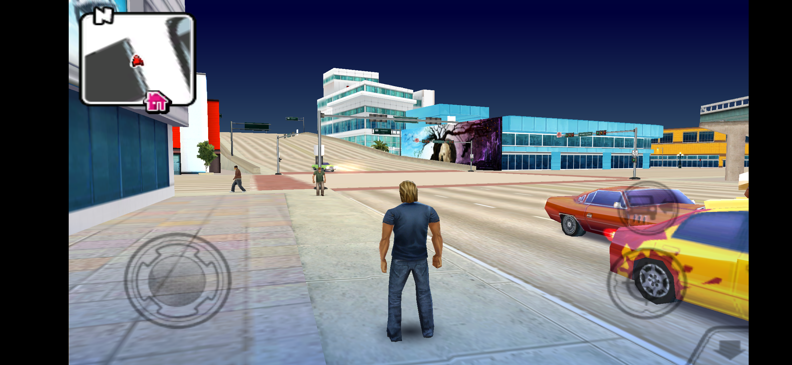

# Gangstar: Miami Vindication: correção para Android moderno

🌐 [Español](README.es.md) · [English](README.md) · **Português**

APK corrigido de **Gangstar: Miami Vindication v1.0.6 "Fix"**, o mod de **David Rice (gameloftrepairgames)**, que **não trava mais ao reabrir o jogo** e funciona com o APK assinado novamente. Testado em um Samsung Galaxy A34 5G com Android 16.

> Projeto de fãs sem fins lucrativos, sem relação com a Gameloft. Gangstar é propriedade da Gameloft. O jogo foi retirado das lojas; este é um arquivo de preservação. Se a Gameloft solicitar a remoção, ele será removido.

## Capturas de tela

<p align="center">
  
  <br>
  
  
</p>

<p align="center"><em>Rodando em um Samsung Galaxy A34 5G, Android 16.</em></p>

## O problema original

O jogo abre normalmente **na primeira vez** após a instalação. Mas assim que o arquivo de save é criado, a próxima abertura falha:

1. Você instala o APK do mod e abre: funciona.
2. Você joga, altera alguma configuração e sai (botão voltar). Nesse momento o jogo grava o `Gangstar2.preferences` na memória interna do app.
3. Ao abrir de novo (ou depois de um `am force-stop`), **o jogo fecha logo depois do logo da Gameloft**.

Isso acontece com o APK original sem modificações. Enquanto o arquivo não existe, o jogo nunca falha; depois que ele existe, falha sempre. Apagar a pasta `Gangstar2` do `/sdcard` não resolve, porque o save e as preferências ficam na memória interna do app. O log mostrava:

```
Abort message: 'stack corruption detected (-fstack-protector)'
libGangster2.so (Preferences::LoadAndApply(char const*)+734)
```

## Instalação

1. Baixe o `gangstar-miami-vindication-fixed.apk` em **Releases**.
2. Copie os dados do jogo para `/sdcard/gameloft/games/Gangstar2` (os mesmos do mod original; o `intro.m4v` fica ali).
3. Se você tem o APK original do mod instalado, **desinstale-o primeiro**: a assinatura é diferente e o save será perdido.
4. Instale e abra.

```bash
adb install --bypass-low-target-sdk-block gangstar-miami-vindication-fixed.apk
```

O `--bypass-low-target-sdk-block` é necessário porque o APK original declara `targetSdk=5`.

**SHA-256 do APK:** `036cb223cbe11e08a881a80a8d34f0babcad66b8db2018dfbe2e98b2fd985a67`

## Requisitos

- Android com suporte a apps de 32 bits (ABI `armeabi`). Testado em Android 16 (Galaxy A34 5G, arm64 com suporte a 32 bits).
- Os dados do jogo em `/sdcard/gameloft/games/Gangstar2`.
- Não testado em outros dispositivos nem versões do Android.

## O que foi corrigido

| # | Sintoma | Quando |
|---|---|---|
| 1 | O jogo fecha logo depois do logo da Gameloft | A partir da segunda abertura, com o arquivo de save já criado |
| 2 | O APK assinado novamente fecha sozinho depois do logo | Sempre, desde a primeira abertura |

### 1. `sprintf("%f", int)` estoura um buffer da pilha

`Preferences::LoadAndApply(char const*)` em `libGangster2.so` lê o `Gangstar2.preferences`. Ao aplicar o volume da música, ele faz:

```
memset(buf, 0, 96);
sprintf(buf, "%f", <inteiro do arquivo>);   // 0x2c059c
```

O formato `%f` espera um `double`, mas é passado um inteiro. Na ABI ARM o `double` é lido de `r2:r3`: `r2` traz o inteiro e `r3` traz lixo. O resultado é um número gigante impresso em decimal que não cabe em 96 bytes e sobrescreve o canário da pilha. Isso é consistente com o observado: aborto com `stack corruption detected (-fstack-protector)` e, sem a checagem do canário, registradores cheios de dígitos ASCII.

O resultado do `sprintf` não é usado (o volume é aplicado a partir do inteiro bruto), então basta anulá-lo.

**Patch:** em `lib/armeabi/libGangster2.so`, offset de arquivo `0x2c059c`:

```
b4 f7 fa e9   (blx sprintf)   ->   00 bf 00 bf   (nop; nop)
```

### 2. `libStormGLOFT.so` lê o certificado do próprio APK

`libStormGLOFT.so` (a biblioteca do mod que instala hooks em `libGangster2.so`) abre o APK como zip, percorre as entradas `META-INF/*.RSA` e as lê. Se não encontra o certificado original, o jogo chama `nativeExit` por conta própria (`Native Exit Triggered` e `System.exit(0)`) durante o `Application::Init`. Não é um crash: é uma saída voluntária.

O que o storm faz exatamente com o `.RSA` (comparar, calcular hash, etc.) **não foi totalmente esclarecido**. O que está comprovado: se o `MYAPP.RSA` original continua dentro do zip, o jogo inicia mesmo com o APK assinado com outra chave.

**Solução:** mover o `MYAPP.RSA` para `META-INF/o/MYAPP.RSA` (o storm o encontra ali e o `apksigner` não o apaga), remover o `MANIFEST.MF` e o `MYAPP.SF` originais e assinar **somente com o esquema v2**.

## Compile você mesmo

Com o seu próprio `orig.apk` do mod original (https://archive.org/details/gangstar-miami-vindication-data):

```bash
keytool -genkey -v -keystore debug.jks -alias k -keyalg RSA -keysize 2048 -validity 10000 \
        -storepass android -keypass android -dname "CN=debug"
python3 patch_gangstar.py orig.apk saida.apk
```

Requer `python3`, `zipalign` e `apksigner`. O `patch_gangstar.py` verifica se os bytes em `0x2c059c` coincidem antes de aplicar o patch.

## Verificação

```bash
adb logcat -c
adb shell monkey -p com.gameloft.android.GAND.GloftGMHP.ML -c android.intent.category.LAUNCHER 1
sleep 20
adb shell pidof com.gameloft.android.GAND.GloftGMHP.ML
adb logcat -d | grep -i "Native Exit\|App Init Succ\|Fatal signal"
```

Esperado: um PID, `App Init Successful` e nenhum `Native Exit Triggered`. Para o bug 1: altere uma configuração, saia com o botão voltar, `am force-stop` e reabra.

## O que NÃO funciona (descartado)

| Tentativa | Resultado |
|---|---|
| Anular a checagem do canário em `LoadAndApply` | Troca o aborto limpo por um `SIGBUS`: a pilha fica destruída |
| Anular o hook `nativeExit` do storm (`0x3246e`) | Evita a saída, mas deixa **tela preta** (áudio e toque continuam) |
| `android:debuggable=true` | Não influencia |
| Nome do assinante v1, `zipalign`, instalação incremental | Não influenciam |
| NOP no flag lido pelo `nativeExit` (`0x368916`) | Sem efeito: há outros chamadores |

O histórico completo está em [`LOG.md`](LOG.md) (em espanhol).

## Limitações conhecidas

- Apenas o `sprintf` da música foi anulado. Não foi confirmado se existe um equivalente na ramificação do volume de efeitos.
- O APK está assinado com uma chave de teste (`CN=debug`). Para atualizar sobre uma instalação existente é preciso um APK assinado com essa mesma chave.

## Créditos

- Jogo original: Gameloft.
- Mod "Fix" / "Vindication" para dispositivos modernos: **David Rice (gameloftrepairgames / Gameloft Repair Games)**.
- Análise e patch para Android 16: este repositório.
- Análise assistida por Claude (Anthropic).
